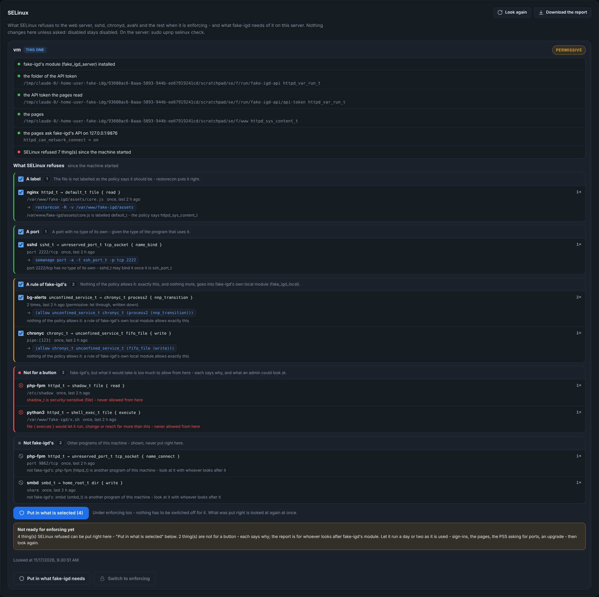
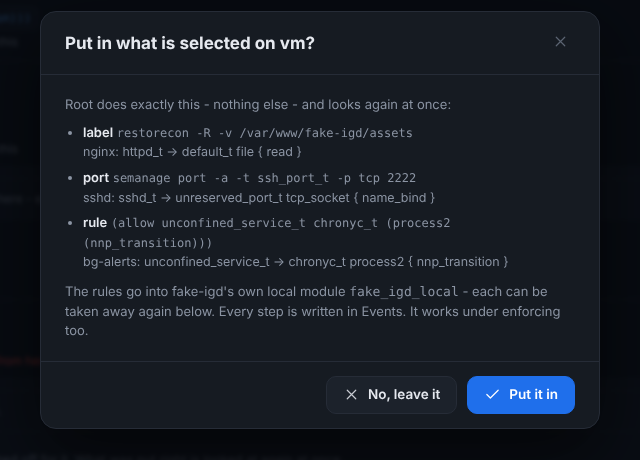
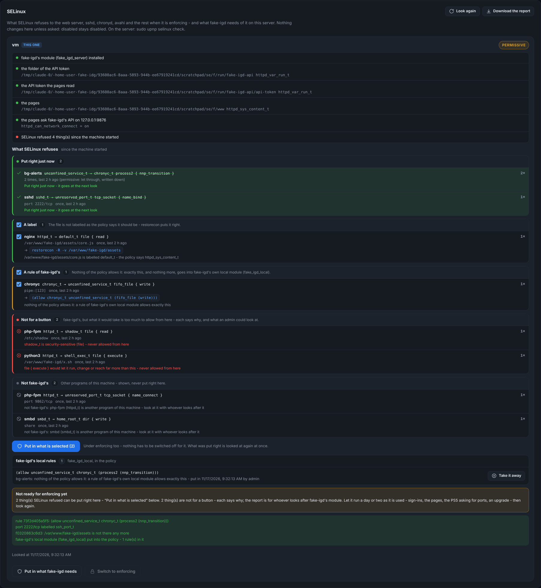
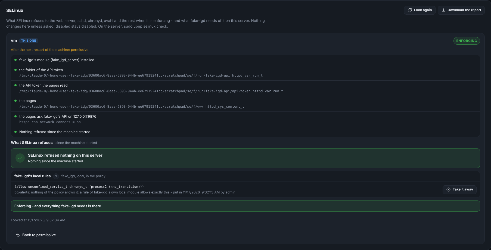
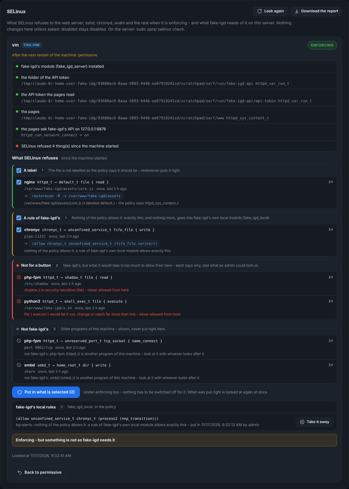
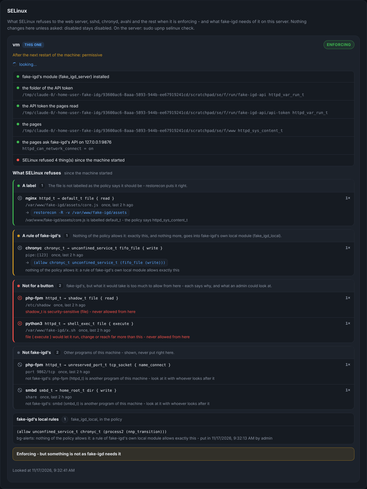
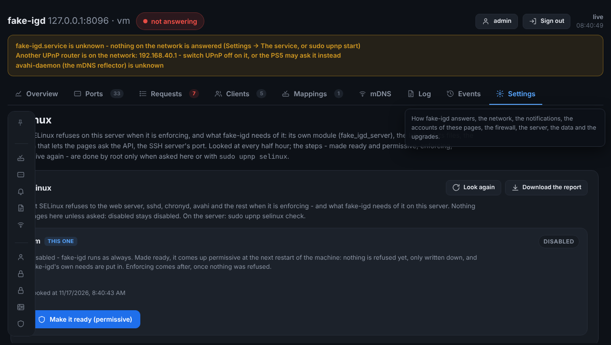
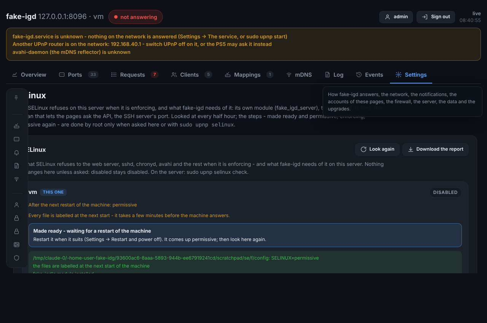

# SELinux in fake-igd - a kit for other applications

How fake-igd (1.7.7 - 1.7.11, modelled on otp 1.0.288) lives with SELinux on EL9: its own policy module,
what the installer does, a Settings card that **finds out everything SELinux refuses on the server and
sorts it by what puts it right**, a button that puts right what may safely be put right, the steps
disabled → permissive → enforcing, a report, the command line. Written so the same can be built into another
application of the same shape: *nginx + php-fpm (confined, httpd_t) → a local API → root's helper*, the
program and its API started by systemd from /opt (unconfined_service_t).

The screenshots come from a test environment with stand-in SELinux tools (getenforce, semanage, semodule,
ausearch, audit2why…) - the paths under /tmp/... are that environment's.

## 1. What SELinux means for such an application

| Who | Domain | What it needs |
|---|---|---|
| nginx, php-fpm (the pages) | `httpd_t` (confined) | read the pages (`httpd_sys_content_t`), **read the API's token** in /run/APP-api, **connect to the API on 127.0.0.1** (boolean `httpd_can_network_connect`) |
| the program and its API (systemd, from /opt) | `unconfined_service_t` | nothing for itself - but with `NoNewPrivileges=yes` every tool it runs **that has a domain of its own** (chronyc, ip, hostname, ssh/sftp/scp, ssh-keygen, ping) needs `process2 { nnp_transition nosuid_transition }` |
| systemd (`RuntimeDirectory=`) | `init_t` | set owner and mode in the API's run folder |
| sshd on another port | `sshd_t` | the port labelled `ssh_port_t` |
| root's helper | `unconfined_service_t` (no NoNewPrivileges) | - |

## 2. The policy module - `fake_igd_server.cil` (beside this file)

CIL, loaded with `semodule -i fake_igd_server.cil`, taken away with `semodule -r fake_igd_server`.
Labels first, a narrow rule only where no label or boolean does it, **each rule in an `(optional …)` block
of its own** so a policy lacking one type still takes the rest:

```
(filecon "/run/fake-igd-api"     dir (system_u object_r httpd_var_run_t ((s0) (s0))))
(filecon "/run/fake-igd-api/.*"  any (system_u object_r httpd_var_run_t ((s0) (s0))))
(filecon "/var/run/fake-igd-api" ...)            ; both spellings: file_contexts.subs_dist
(optional fake_igd_server_systemd_runtime
    (allow init_t httpd_var_run_t (dir (getattr setattr search open read)))
    (allow init_t httpd_var_run_t (file (getattr setattr))))
(optional fake_igd_server_nnp_chronyc
    (allow unconfined_service_t chronyc_t (process2 (nnp_transition nosuid_transition))))
... ifconfig_t, hostname_t, ssh_keygen_t, ssh_t, ping_t
```

Checked with `secilc` against a full reference policy (plus a stub `(type unconfined_service_t)`).
The `nnp_transition` rules came from a real refusal on a user's server:
`unconfined_service_t → chronyc_t process2 { nnp_transition }`, program `bg-alerts` (the API's thread
reading the clock with `chronyc`) - under enforcing chronyc would not have run at all.

## 3. The installer (install.sh - fresh install and every upgrade, with or without the pages)

1. Puts in the SELinux tools if missing: `policycoreutils libselinux-utils policycoreutils-python-utils
   audit selinux-policy-targeted`; starts `auditd` where SELinux is on (without it nothing is written down).
   **Never changes the mode.**
2. Copies the module beside the program; `semodule -i` **only when it differs** from the copy last put in
   (`fake_igd_server.cil.in-policy`) - an upgrade without a change does not reload the policy.
3. Takes away an older hand-made `semanage fcontext` rule once the module labels the folder; warns when
   `matchpathcon` still does not say `httpd_var_run_t`.
4. `setsebool -P httpd_can_network_connect 1`; `restorecon -R` of its folders.
5. Writes what it did into `root-facts.json` (`selinux_module: in|failed|off`) for the pages.
6. `uninstall.sh`: `semodule -r fake_igd_server fake_igd_local`; the mode, booleans and port labels stay.

## 4. The card - Settings → SELinux

### 4.1 The checks (what the application itself needs)

A dot per line: the module in the policy; the label of the API's folder and token; the label of the pages;
the boolean that lets the pages ask the API; the SSH port's type (if not 22); the mode now and after a
restart (`/etc/selinux/config`, `selinux=0` on the kernel's command line).

### 4.2 "What SELinux refuses" - Look again = a full analysis (root, `root_selinux_find.py`)

Every `AVC`, `USER_AVC`, `SELINUX_ERR` since the machine started (`ausearch -ts boot`), read **with the
records of its event** (SYSCALL: the program; PATH: the whole path; the port), grouped by
*(source type, target type, class, permissions, program, path/port)*, each group put to `audit2why`, and
sorted into one kind. A finding's id is a hash of what was refused (12 hex) - the same refusal has the same
id at every look.

| Kind | Meaning | Put right by |
|---|---|---|
| allowed now | the policy loaded now allows it | - (not counted) |
| **Boolean** | audit2why names a boolean | `setsebool -P NAME 1` - never a boolean that allows far more (`*exec*`, `unconfined`, `*_manage_all*`, `*_read_all*`, `ptrace`, `deny_*`…) |
| **Label** | the file is not labelled as `matchpathcon` says | `restorecon -R -v PATH` |
| **Port** | a confined program the application runs (nginx, sshd, chronyd, avahi) binds/connects to a port of no type of its own | `semanage port -a -t TYPE -p PROTO PORT` (`http_port_t`, `ssh_port_t`, `ntp_port_t`, `howl_port_t`) - never a port another service's type has |
| **Rule of fake-igd's** | nothing of the policy allows it, and it is safe to allow exactly that | one rule in a **second local module** `fake_igd_local`: `(optional fake_igd_local_ID (allow SRC TGT (CLASS (PERMS))))` |
| **Not for a button** | the application's, but too much to allow from a page | shown with *why* - never put right: a security-sensitive target (`shadow_t`, `security_t`, the policy, `kernel_t`, keys, audit, `sudo_*`, home…), executing (`execute`, `entrypoint`, `exec*`, `transition`, `ptrace`, `relabel*`, capabilities like `sys_admin`, `dac_override`…), unsafe classes (`security`, `kernel_service`, `key`, `bpf`…), writes to generic types (`etc_t`, `usr_t`, `bin_t`, `var_t`, `default_t`, `tmp_t`…) |
| **Not fake-igd's** | another program of the machine | shown, never put right here |

**Whose refusal it is**: the application's own domain (`unconfined_service_t`) when the program is the
application's (exe under /opt/fake-igd, its comm/proctitle), the tools it starts (chronyc_t, ifconfig_t, ssh_t…),
and the confined services it works with (httpd_t, sshd_t, init_t, logrotate_t…) **only when the path is
one of the application's paths or the port one of its ports** (a list: /opt/APP, /var/lib/APP, /var/www/APP,
/run/APP-api, its nginx/php-fpm/sshd/journald/logrotate drop-ins, the API port, the SSH port…).

### 4.3 Put in what is selected (N)

- Every fixable finding comes ticked; group headers have *select all*; the button counts.
- **The page sends only the ids.** Root finds them again in the audit log and works out every fix itself -
  a request never carries a rule, a path or a command.
- A confirm lists **exactly** what root will do (screenshot 3).
- Root: `setsebool -P`, `restorecon`, `semanage port`, the local module rebuilt from its list and loaded
  (`semodule -i`, copy kept as `.in-policy`); every step written in Events; then *Look again* at once.
- Works **under enforcing** too - nothing has to be switched off.
- What was put right is noted with its time: a refusal of it from before no longer counts; from after, it
  comes back.
- "fake-igd's local rules (N)" lists each rule with **Take it away** (the last one: `semodule -r`).

### 4.4 The steps (as otp)

| Now | Button | Root does |
|---|---|---|
| disabled | **Make it ready (permissive)** | the module, labels (`/.autorelabel`), booleans, ports put in; `SELINUX=permissive` in /etc/selinux/config; `selinux=0` taken off the kernel's command line; never restarts the machine |
| permissive, something fixable or not-for-a-button left | *Switch to enforcing* **locked**; "Not ready for enforcing yet" says how many | - |
| permissive, nothing left | **Switch to enforcing** | `setenforce 1` + `SELINUX=enforcing` |
| enforcing | **Back to permissive** | `setenforce 0` + `SELINUX=permissive` |

"Let it run a day or two as it is used - sign-ins, the pages, the PS5 asking for ports, an upgrade - then
look again": refusals appear only when the thing is done.

### 4.5 Download the report (`selinux-report.tar.gz`, nothing is changed to make it)

| File | What |
|---|---|
| `check.json` | the card |
| `avc-raw.txt`, `avc.txt` | every refusal since the start, raw and `ausearch -i` - **of the whole machine** |
| `audit2why.txt`, `audit2allow.te` | why; what would allow it (a hint, never loaded) |
| `labels.txt` | the application's files, their labels and what `matchpathcon` says |
| `processes.txt`, `ports.txt`, `booleans.txt`, `modules.txt` | the application's part of them |
| `system.txt` | os-release, kernel, `sestatus -v`, the packages, the kernel's command line, the config, auditd |
| `os/processes.txt` | **every** process with its domain |
| `os/booleans.txt` | **every** boolean (`getsebool -a`) |
| `os/ports.txt` | **every** port type (`semanage port -l`) |
| `os/modules.txt` | **every** module (`semodule -lfull`) |
| `os/local-changes.txt` | what was changed on this machine: `semanage boolean/port/fcontext/login/user/module/permissive -l -C` |
| `os/semanage-export.txt` | `semanage export` - all local customisations, as they can be imported elsewhere |
| `os/listening.txt` | `ss -lntupZ` - every listening socket with its label |

No password, key or token of the application is in it; the audit log and the process list hold the command
lines of other programs - look through them before sending the file on.

## 5. Command line

```bash
sudo upnp selinux check                 # the card's checks, the mode
sudo upnp selinux look                  # the findings, grouped and coloured, with ids and fixes
sudo upnp selinux fix ID... | --all     # lists what root will do, asks (--yes)
sudo upnp selinux rules [--take-away ID]
sudo upnp selinux prepare | enforce | permissive
sudo upnp selinux report [FILE]
```

## 6. Screenshots

| | |
|---|---|
|  **1. Findings, sorted** - label, port, rules of fake-igd's (ticked); not for a button (red, why); not fake-igd's (grey) |  **2. The same at 1280** |
|  **3. The confirm** - exactly what root will do |  **4. After Put in** - "Put right just now" (green), the local rule listed |
|  **5. Enforcing, nothing refused** - the calm green state, the local rules, Back to permissive |  **6. Enforcing, something refused** - fixable under enforcing too |
|  **7. A read-only account** - the card, no buttons |  **8. Disabled** - Make it ready (permissive) |
|  **9. Made ready** - waiting for a restart of the machine | |

## 7. Putting it into another application - a checklist

1. **Map the domains** (§1): which of your processes are confined (the web server, sshd…), which are
   `unconfined_service_t`, which tools your services run that have their own domain.
2. **Write your module in CIL**: labels (`filecon`) for your run/state folders the confined web server reads;
   `nnp_transition` for the tools of a `NoNewPrivileges` unit; every rule in an `optional` block. Check it
   with `secilc` against a reference policy.
3. **Installer**: the tools, auditd, the module only when changed (`.in-policy` copy), booleans, `restorecon`,
   never touch the mode; uninstall takes your modules away.
4. **Root's helper**: check / look / fix / steps / report; derive every fix itself; a request names only
   finding ids; refuse the dangerous kinds by lists (§4.2); a local module of your own for the rules, each
   optional, each removable.
5. **The card**: the checks; findings grouped by kind with counts and select-all; the program,
   `SRC → TGT class { perms }`, path/port, count and when; the command preview; a confirm listing exactly
   what will be done; green "put right"; the local rules with Take it away; the steps with enforcing locked
   until nothing is left; read-only accounts see it without buttons.
6. **CLI** with the same verbs (look, fix, rules, steps, report).
7. **Alerts / "To be done by hand"**: "SELinux refuses APP something - N can be put right on the card";
   look again as soon as a step was done.
8. **Test** without SELinux: stand-in tools (getenforce, getsebool, semanage, semodule, ausearch, audit2why,
   matchpathcon, restorecon) that read/write files; fixtures of real `ausearch` output (raw: hex-encoded
   strings - decode only `proctitle name path comm exe cwd`, never a port).

## 8. Files in fake-igd

| File | Part |
|---|---|
| `deploy/fake_igd_server.cil` | the module |
| `deploy/root_selinux.py` | root: check, prepare, enforce, permissive, look, fix, rule_drop, report |
| `deploy/root_selinux_find.py` | the analysis: reading the audit log, grouping, audit2why, sorting, the local module |
| `src/api_selinux.py` | the API: `GET/POST /api/selinux` (`check`, `prepare`, `enforce`, `permissive`, `report`, `download`, `fix {ids}`, `rule_drop {rule}`) |
| `web/assets/pane-selinux.js`, `web/admin/panes/selinux.php` | the card |
| `src/upnp_admin.py` (`cmd_selinux`), `src/upnp_console.py` | CLI and console |
| `install.sh` (`selinux_tools`, `selinux_module`), `uninstall.sh` | install / uninstall |
| `src/api_alerts.py`, `src/api_upgrade.py` | the alert, "To be done by hand" |

`example-fake_igd_local.cil` beside this file: what the local module looks like after "Put in".
