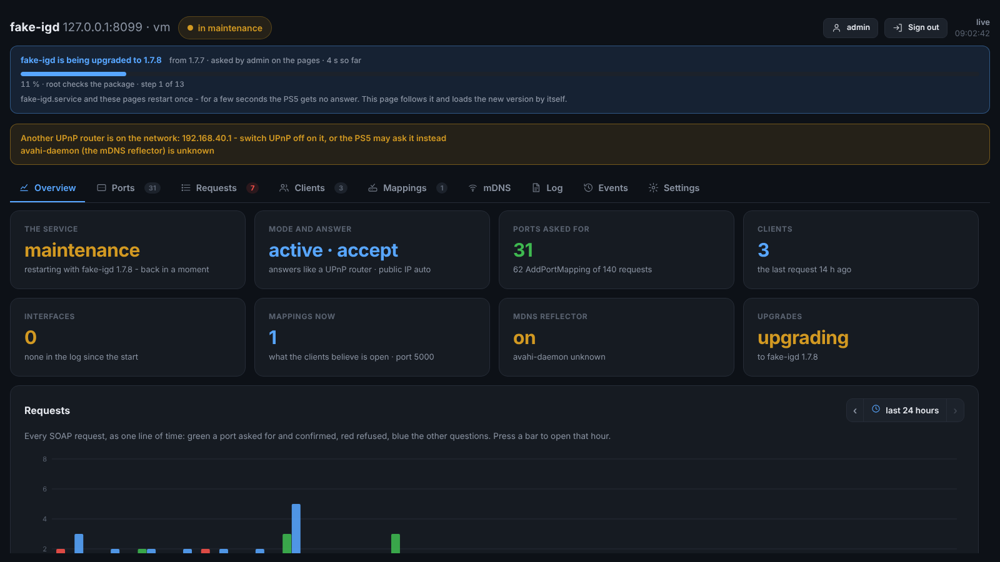
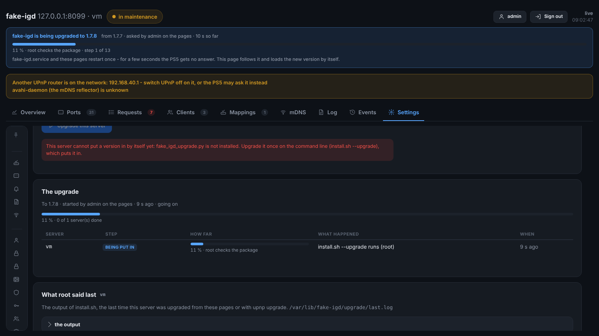
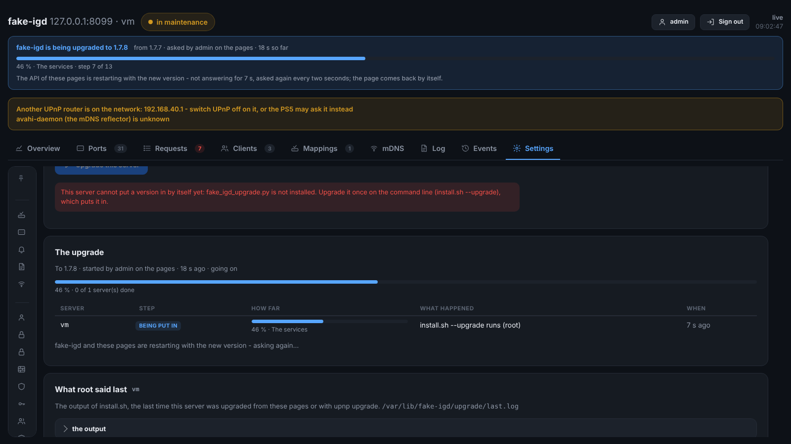
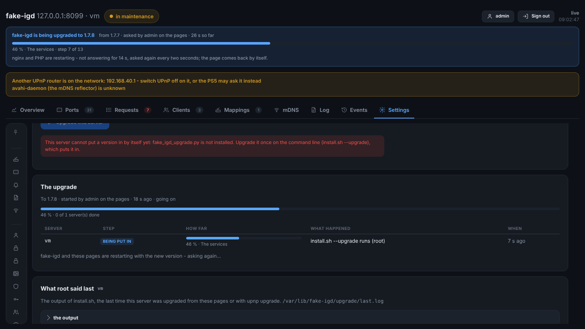
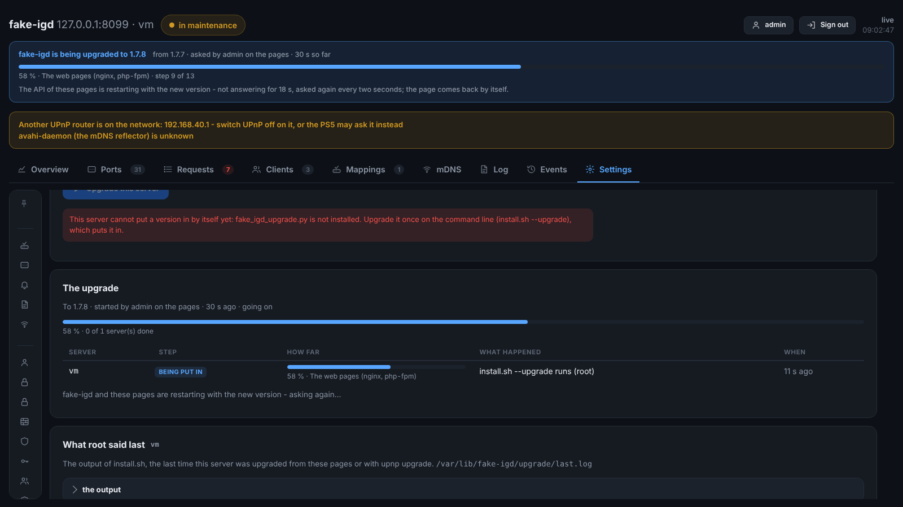
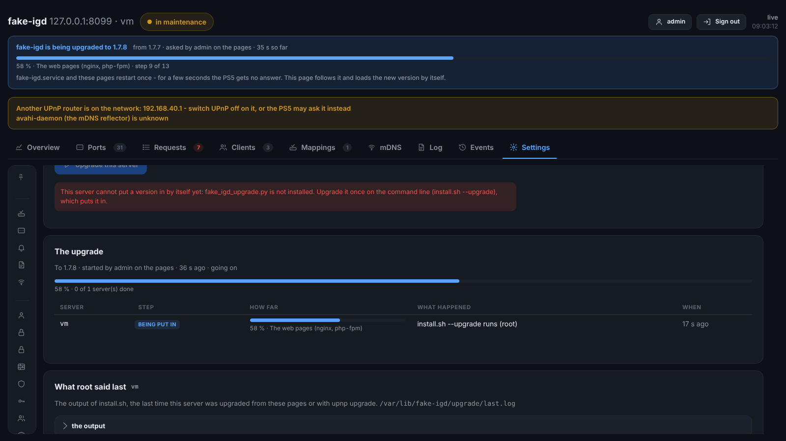
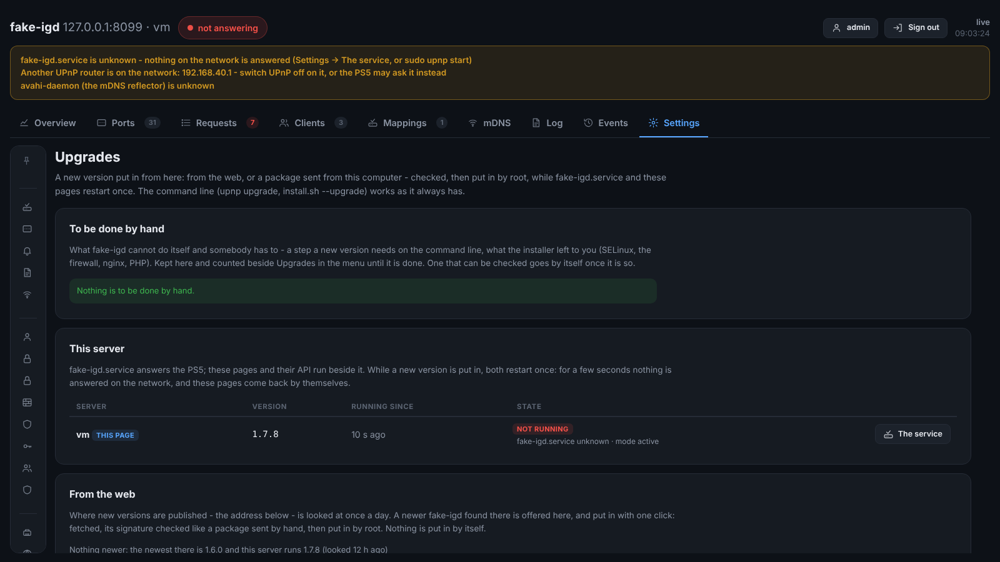
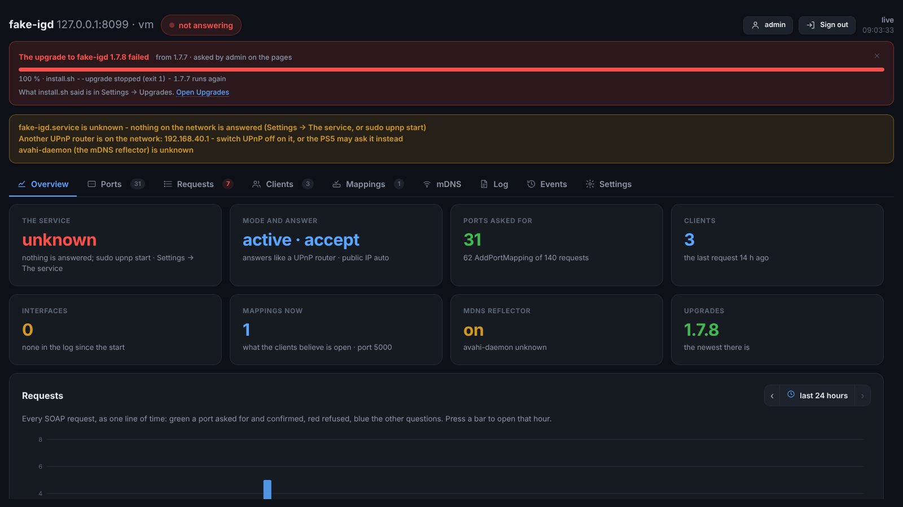
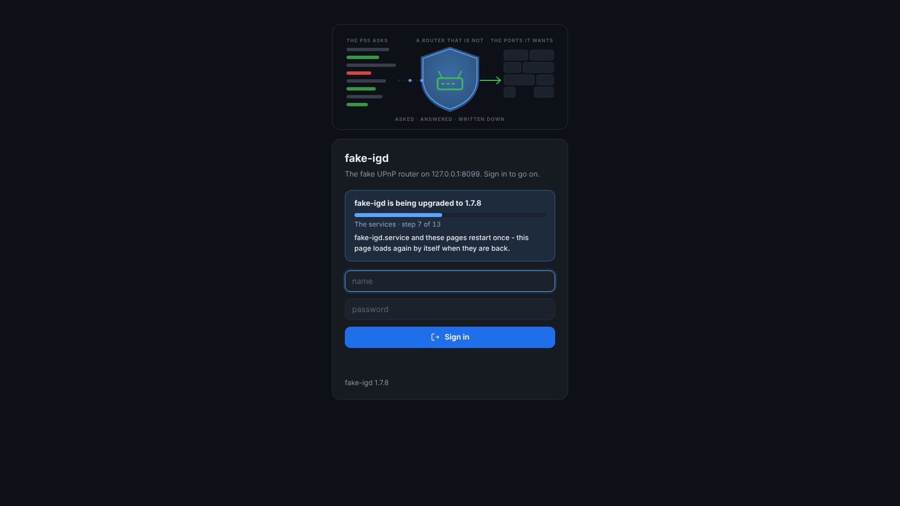

# The upgrade UI - how the pages stay with an upgrade that restarts them

How fake-igd (1.7.2+, modelled on otp's maintenance) shows an upgrade **while the very things that serve
the pages restart**: the program, its API, nginx and PHP. Written so the same pattern can be put into
another application with the same shape: *browser → nginx → PHP (thin relay) → a local API → a database*,
upgraded by a root helper that runs the package's own `install.sh --upgrade`.

The screenshots are from a test environment (an upgrade simulated step by step). The yellow
"Another UPnP router…" box and the red "…is not installed" note are artefacts of that environment.

## 1. The problem

During an upgrade the API restarts, then nginx and PHP. Without anything special every request of the
page fails with 503 "the API is not answering", the page draws a red "down" bar and every pane a red
toast - exactly when the operator should be told "this is expected, wait". And once it is over the page
still runs the *old* JavaScript against the *new* API.

## 2. The idea in one paragraph

Whoever does the upgrade writes **how far it is** into one small JSON file that **PHP reads straight from
disk** - not through the API. While the API answers, PHP merges it into the status; while it does not,
PHP answers every API call with `503 {"upgrading": {...}}` instead of "not answering", and a dedicated
`?api=upgrade-state` keeps working. The page treats such a 503 as *expected*, shows a band with the
progress, keeps asking every 2 s, and when the state says `done` (and it saw it running) it **reloads
itself once** onto the new pages. A failure is a red band with a link to the log.

## 3. The progress file - the only contract

`/var/www/fake-igd/.upgrade.json` (beside the pages, so PHP may read it; a dot name, which nginx refuses
to serve: `location ~ /\. { deny all; }`). Root's, mode 0644, written to a temp file and renamed - never
half written. Nothing secret in it.

```json
{"state": "running", "id": "k1", "version": "1.7.8", "from": "1.7.7",
 "by": "admin on the pages", "part": 7, "parts": 13, "words": "The services",
 "started": 1794900000, "at": 1794900042,
 "said": "", "downgrade": false}
```

| Field | Meaning |
|---|---|
| `state` | `running`, `done` or `failed` - nothing else is believed |
| `id` | the upgrade's id (the request's), to tell one upgrade from the next |
| `version`, `from` | to and from (digits and dots only - checked by PHP) |
| `by` | who asked - shown only to a page with a session cookie |
| `part`, `parts` | step N of M (install.sh counts its own `step` calls: 10, or 13 with the pages) |
| `words` | the step's words, as install.sh prints them (`==> The services`) |
| `started`, `at` | when it began, when this was written (seconds) |
| `said` | on `failed`: the reason in one line ("install.sh --upgrade stopped (exit 1) - 1.7.7 runs again") |
| `downgrade` | going back to an older version (words change: "taken back to") |

**Freshness** (PHP, `igd_upgrading()` in `web/igd-api.php`): `running` is believed for 30 min after `at`
(longer than install.sh may take), `done`/`failed` for 10 min (as long as a page may take to see it).
Older, or `at` in the future, or not one of the three states: as if there were no file. Every text field
is stripped of control characters and cut.

### Who writes it

| Writer | When |
|---|---|
| `deploy/fake_igd_upgrade.py` (root, started by `fake-igd-upgrade.path`) | `running` when it takes the request (checking the package), `failed` if the check or install.sh fails, `done` at the end |
| `install.sh --upgrade` (root - also when run by hand) | `upgrade_tell running "<step>"` from inside its `step()` function, `done` at the end, `failed` from its EXIT trap (with `exit 130/129/143` traps for INT/HUP/TERM, so a killed run is not left "running") |
| the CLI `upnp upgrade …` | goes through the same request.json → the same helper → the same file |

The bash writer is ~15 lines (see `install.sh`, `upgrade_tell`): `printf` the JSON into `mktemp` in the
same folder, `chmod 0644`, `mv -f` over the file.

## 4. PHP - the pages' side (`web/igd-api.php`, `web/admin/index.php`)

- `igd_upgrading()` reads, checks and caches the file per request.
- **Every API call relayed while the API does not answer** (`igd_relay`): if `igd_upgrading()` says
  something, answer `503 {"ok": false, "upgrading": {...}, "error": "being upgraded"}` - not
  "the API is not answering".
- **`?api=status`** (while the API answers): the file is merged in as `upgrading`, so the band appears at
  once, before anything restarts.
- **`?api=upgrade-state`** (GET, needs no API at all): `{"upgrading": {...}, "pages": "<version of the
  PHP files on disk>", "api": <does /api/health answer now>}`. `by`, `said`, `id` only with a session.
- **The sign-in page**, rendered while the API is down during an upgrade: draws the same band
  (server-side, from the file) and a few lines of JS that ask `?api=upgrade-state` every 2 s and reload
  when `api` is true.
- **`/healthz`** during an upgrade: `503 maintenance NODE: being upgraded to X` (a monitor sees
  maintenance, not "down").

## 5. The browser (`web/assets/core.js`, `admin.js`, `pane-upgrade.js`)

| Piece | What it does |
|---|---|
| `api()` in core.js | a 503 carrying `upgrading` is marked `unreachable + upgrading`, handed to `upgradeHeard()`, and **not** turned into a red toast |
| `oops()` | silent while an upgrade is expected (`upgradeExpected()`) |
| `UPG` state in admin.js | `u` (last state), `heard`/`away` (when the API was last heard / since when it is away), `sawRunning`, `reloading` |
| the tick | every 2 s while an upgrade is known: `?api=status`, and while that fails `?api=upgrade-state` |
| `#upband` (under the header) | `fake-igd is being upgraded to X` · `from Y · asked by Z · 1 min 12 s so far`, a bar (`upgradePercent`: done steps of `parts`), `NN % · <words> · step N of M`, and one line of what it means: *"fake-igd.service and these pages restart once - … This page follows it and loads the new version by itself."* While the API (or nginx/PHP) is away: *"The API of these pages is restarting with the new version - not answering for 7 s, asked again every two seconds"* |
| the pill | `in maintenance` (yellow) instead of `answering` / `not answering` |
| the cards | the service card `maintenance - restarting with X - back in a moment`, the Upgrades card `upgrading` |
| problems bar | "fake-igd.service is …" lines hidden while an upgrade runs (the service restarts on purpose) |
| `#offline` (the red "down" bar) | stays hidden while an upgrade is expected |
| Settings → Upgrades | "The upgrade" card: the whole bar, and a row of this server (Step / How far / What happened / When), drawn from the file while the API is away; root's output (`last.log`) below |
| **the end** | state `done` after having seen `running` → "Loading the pages of the new version…" and `location.reload()` once (a sessionStorage key prevents a loop). With unsaved changes on the page: no reload, a "Load it again" link instead |
| **a failure** | the band red: "The upgrade to fake-igd X failed", the reason, "What install.sh said is in Settings → Upgrades. Open Upgrades", a × to hide it (remembered for that upgrade's id) |

### The sequence

```
browser            PHP                     API              root helper / install.sh
  | POST upgrade ->  | ---------------------> | request.json -> | (path unit starts it)
  |                  |                        |                 | .upgrade.json: running 1/13
  | status (2 s) ->  | status + upgrading <-  |                 | step 2..6 ...
  | band 11 %        |                        |                 | step 7 "The services"
  |                  |                        |  (restarting)   | systemctl restart API
  | status ------->  | API down: 503 upgrading|                 |
  | band "not answering for 7 s" (no red)     |                 | step 9 nginx, php-fpm
  | upgrade-state -> | (PHP itself away: fetch fails - band says "nginx and PHP are restarting")
  | upgrade-state -> | {upgrading, api:false} |                 | ...
  |                  |                        |  (back, new)    | .upgrade.json: done
  | status ------->  | status + done          |                 |
  | reload once ------------------------------------------------> new pages
```

## 6. Screenshots

| | |
|---|---|
|  **1. Started** - the band, the pill "in maintenance", the cards "maintenance" / "upgrading" |  **2. Settings → Upgrades** - "The upgrade": the bar and the row of this server |
|  **3. The API restarting** - "not answering for 7 s, asked again every two seconds" - no red anywhere |  **4. nginx and PHP restarting** - the page itself cannot be reached; the band says so and goes on asking |
|  **5. PHP back, API not yet** - progress from the file again (step 9 of 13) |  **6. The API answers again** - with the new version |
|  **7. Done** - the page reloaded itself once onto the new version |  **8. Failed** - red band, the reason (here: the version before runs again), a link to Upgrades |
|  **9. Signed out during an upgrade** - the sign-in page shows the band itself (PHP, from the file) and reloads when the API is back | |

## 7. Putting it into another application - a checklist

1. **One file, one writer at a time**: pick a path PHP may read but the web server never serves
   (a dot name + `location ~ /\. { deny all; }`, or outside the docroot with `open_basedir` allowing it).
   Write it atomically (temp + rename), 0644, owned by root. Fields as in §3.
2. **Make the installer report**: wrap its `step()` so each step writes `running N/M words`; an EXIT trap
   writes `failed` with the exit code; `trap 'exit 130' INT; trap 'exit 129' HUP; trap 'exit 143' TERM`
   so a killed run ends as `failed`, not `running` for ever; `done` as the last line. Count the steps
   honestly (`parts`) - the bar is `part/parts`.
3. **Make the root helper report** the steps before install.sh (taking the request, checking the
   package's signature) and its own failures.
4. **PHP**: a reader with freshness limits (30 min running / 10 min ended) and field checks; the relay
   answers `503 {upgrading}` while the API is down and an upgrade is fresh; `?api=upgrade-state` without
   the API; merge into `status` while the API answers; health check says `maintenance`.
5. **JS**: treat `503 + upgrading` as expected (no toast, no red bar); one band under the header; a 2 s
   tick that falls back to `upgrade-state`; the pill/cards say maintenance; hide "service down" problems
   while it runs; reload once at `done` after `running` was seen (guard against loops and unsaved edits);
   a red, dismissible band on `failed` with a link to the log.
6. **Sign-in page**: render the band server-side from the file, poll `upgrade-state`, reload when the API
   answers.
7. **Health/monitoring**: 503 `maintenance` (not `down`) while the file says running; alerts for
   "service down" suppressed while an upgrade runs.
8. **"To be done by hand" / post-upgrade checks**: do not evaluate them while an upgrade runs (the new
   API starts before install.sh has finished putting root's parts in), evaluate again as soon as the
   installer has written its facts.
9. **Test it** by writing the file by hand and killing/starting the API and PHP (see §8).

## 8. How the screenshots were made (a test harness to copy)

A Playwright script signs in, then writes `.upgrade.json` by hand step by step, kills the API process,
kills `php -S`, starts them again, writes `done` / `failed`, and takes a screenshot after each.
See `sim.js` beside this file. The states: running 1/13 → (API killed) running 7/13 → (PHP killed)
running 9/13 → PHP back → API back → done → (separately) failed → signed out during an upgrade.

## 9. Files in fake-igd

| File | Part |
|---|---|
| `deploy/fake_igd_upgrade.py` | the root helper: request.json → checks → install.sh; writes `.upgrade.json` (`PAGES_FILE`) |
| `install.sh` (the `--upgrade` block) | `upgrade_tell`, `step()` wrapper, EXIT/INT/HUP/TERM traps, `done` |
| `web/igd-api.php` | `igd_upgrading()`, the 503 with `upgrading` in `igd_relay` |
| `web/admin/index.php` | `?api=upgrade-state`, `status` merge, the sign-in page's band, `#upband` |
| `web/healthz.php` | `maintenance` |
| `web/assets/core.js` | `api()` 503 handling, `oops()` silence |
| `web/assets/admin.js` | `UPG`, `upgradeWords/Of/FromStatus/Heard/Expected/End/Away/Percent`, the band, pill, cards, reload |
| `web/assets/pane-upgrade.js` | Settings → Upgrades: the plan from the file while the API is away |
| `web/assets/fake-igd.css` | `.offline.upband`, `.upband-head`, `.upband-sub`, `.up-bar` |
